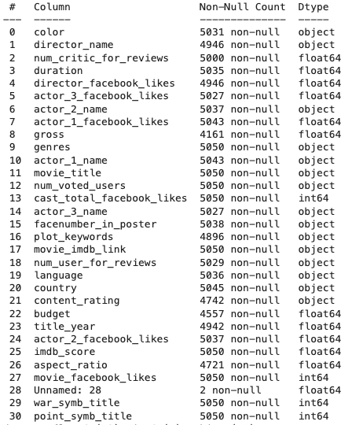
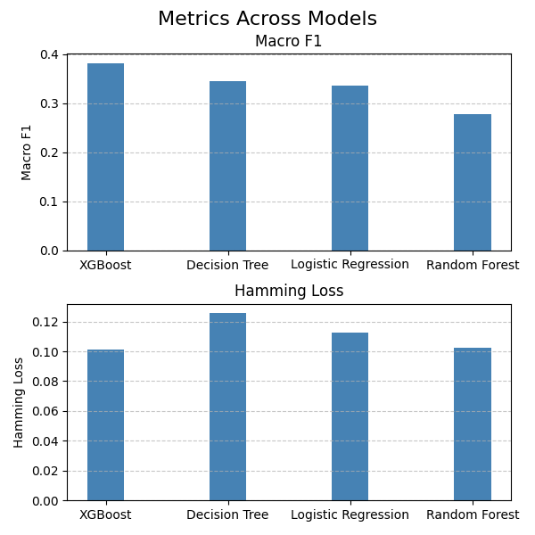
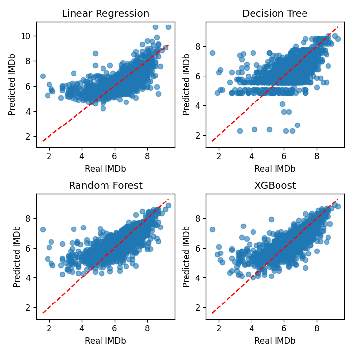
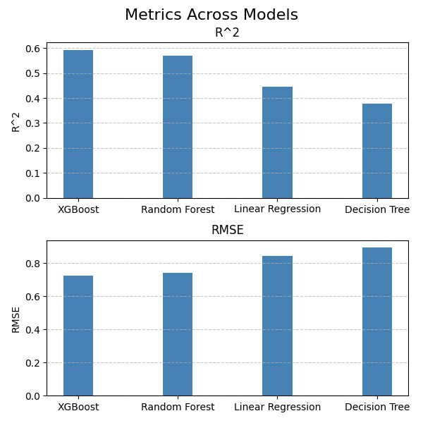
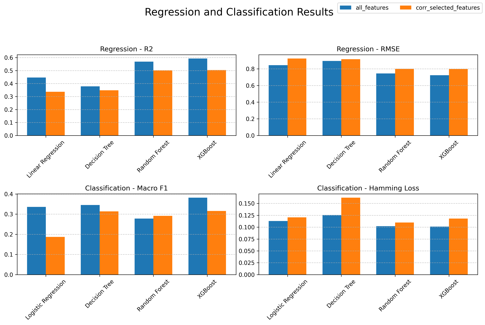

# Movie Analysis: Multi-label Classification & Regression

This repository contains project that explores movie metadata through two distinct lenses: **Multi-label Classification** to predict multiple movie genres for a single film and **Regression** to estimate IMDB scores.

## Project Structure

```
.
├── data/
│   ├── raw/                  # raw dataset (cinemas.csv)
│   └── processed/            # cleaned dataset (cinemas_cleaned.pkl)
├── notebooks/                # Jupyter notebooks (step-by-step analysis)
├── src/                      # source code (preprocessing, models, training scripts)
├── scripts/                  # helper scripts (e.g. results comparison plot)
├── imgs/                     # images used in this README
├── plots/                    # generated plots (output)
└── results/                  # generated metrics (JSON, output)
```


## 1. Data
It contains movie information like title, actors, genre, IMDB score. It consist of over 5000 rows. There are several object columns.



## 2. Preprocessing of data
In preparation stage this steps has been done:
- Dropping nans (only a few of them where here). 
- Casting columns from object
- Filling values (median - outlier resistance, mean-when data are symmetrical - human high)
- Removing duplicates
- Dropping odd values like (Color: Green and Yellow, which was assigned to only one movie)
- Dropping outliers
- One hot encoding of categorical columns (like: language, country, content_rating)
- One hot encoding of multilabel columns (like: genres, keywords) - selected top k categories, assigned OTHER category to the rest

#### Data Pipeline

* **Feature Engineering:** Processing the `genres` string (e.g., `Action|Sci-Fi`) into a binary matrix.
* **Text Processing:** Basic NLP techniques applied to `plot_keywords`.
* **Scaling:** `StandardScaler` applied to numerical features like `budget`, `gross`, and `facebook_likes` for Neural Network stability.


## 3. Multi-label Classification (Genre Prediction)
Unlike standard classification, this task handles overlapping labels:
* **Approach:** One-vs-Rest (OvR) strategy for classical models and multi-output architectures for Neural Networks.
* **Classic ML:** Logistic Regression, Decision Tree, Random Forest, and XGBoost.
* **Deep Learning:** * **Output Layer:** `Sigmoid` activation function to allow multiple independent probabilities.
    * **Loss Function:** `Binary Crossentropy` applied across all label outputs.
    * **Preprocessing:** MultiLabelBinarizer for transforming the `genres` column.

<div align="center">
   
</div>

## 4. Regression (IMDB Score Prediction)
Predicting the exact numerical rating:
* **Classic ML:** Linear Regression, Decision Tree, Random Forest Regressor, and XGBoost.
* **Deep Learning:** * **Architecture:** Multi-layer Perceptron (MLP) with `ReLU` activations.
    * **Output Layer:** Linear activation for continuous value prediction.
    * **Loss Function:** Mean Squared Error (MSE).
      
<div align="center">
   
   
</div>

## 5. Regression and Classification Performence

Removing low-correlation features typically improves (lowers) the Hamming Loss because the model stops making random mistakes on labels it isn't sure about. It becomes more conservative and focuses on the most obvious categories. On the other hand, Macro F1-Score drops because those "weak" features were often the only clues for identifying rare classes. Without them, the model ignores niche categories entirely, which heavily penalizes the Macro average.

By removing features with weak correlations, we simplify the model and reduce noise. This often leads to a lower (better) RMSE, as the model makes smaller, more stable errors and avoids "guessing" wildly. However, $R^2$ may decrease because the model loses the ability to explain "rare events" or subtle variations that only those weak features could capture. In short, the model becomes more reliable on average but explains less of the overall complexity.

<div align="center">
   
</div>

## 6. Installation & Usage

1.  **Clone the repository:**
    ```bash
    git clone https://github.com/metrych-creator/movie-analysis-ml.git
    ```
2.  **Install dependencies:**
    ```bash
    pip install -r requirements.txt
    ```
3.  **Run the analysis:**
    Execute the `notebooks/01_preprocessing.ipynb` notebook (or `python src/preprocessing.py`) to see data preprocessing steps.
    Run `python src/classical_ml.py` to see classic ML methods like: Decision Tree, training, and evaluation steps.
    Run `python src/classification_network.py` to see multilabel classification neural network training, and evaluation steps.
    Run `python src/regression_network.py` to see regression neural network training, and evaluation steps.
    Run `python scripts/plot_feature_selection.py` to compare results for all features vs. correlation-selected features.
---
